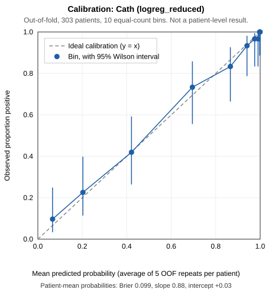
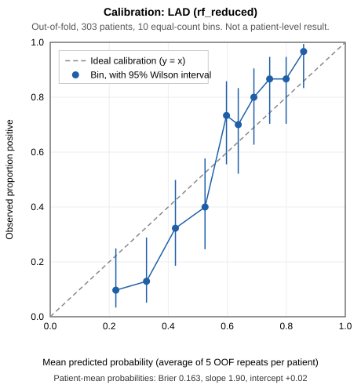
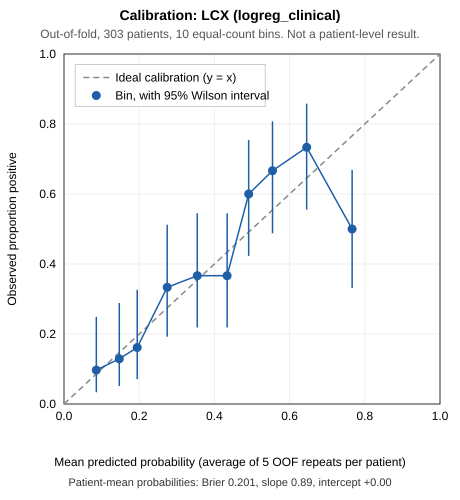
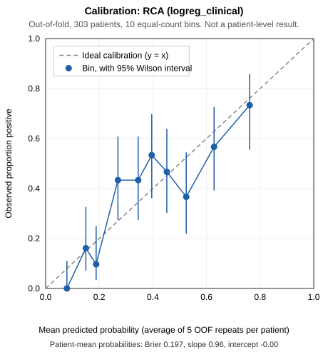

# Final ML evaluation: calibration, thresholds, bootstrap CIs, row 93

> **Educational decision-support prototype. Not a diagnostic tool.** Every number below is an internal cross-validation estimate on 303 patients from one centre. Nothing here is external or clinical validation.

Generated by `scripts/final_ml_evaluation.py`. Selected models: Cath `logreg_reduced`, LAD `rf_reduced`, LCX `logreg_clinical`, RCA `logreg_clinical`.

## How the predictions were obtained

- `reports/phase1_modeling/oof_predictions.csv` stores only each patient's **mean and SD** of the 5 out-of-fold (OOF) predictions, not the 5 individual predictions.
- To keep each patient's repeated predictions together, this script re-ran the **existing** Phase 1 CV protocol for the four selected models only (same splits, same `train_phase1.make_pipeline`, estimator settings cloned from each saved pipeline).
- The models fitted for this were kept in memory only; no saved model or Phase 1 report was changed.
- **Reproduction check passed for every task**: the regenerated predictions match the saved OOF means and the saved per-fold ROC-AUCs (see `final_ml_evaluation_log.txt`). They are saved in `oof_per_repeat_selected.csv` (303 patients x 5 repeats per task).
- In total, 200 fits were run: 100 for the primary protocol and 100 for the row 93 exclusion.

Two kinds of summary are used and are never mixed:
- **Repeat-averaged** (primary): each metric is computed on one repeat's 303 OOF predictions (one per patient), then averaged over the 5 repeats.
- **Patient-mean probability**: each patient's 5 predictions are averaged first, then metrics are computed once. This is used for the calibration plots, because it gives one point per patient.
- In neither case are the 5 predictions treated as 5 patients.

## A. Calibration

| Task | Prevalence | Mean predicted | Brier | Calibration intercept | Calibration slope | Plot |
|---|---|---|---|---|---|---|
| Cath | 0.713 | 0.711 | 0.103 | +0.03 | 0.80 (repeats 0.77–0.84) |  |
| LAD | 0.584 | 0.580 | 0.164 | +0.02 | 1.82 (repeats 1.75–1.85) |  |
| LCX | 0.393 | 0.392 | 0.202 | +0.00 | 0.87 (repeats 0.85–0.88) |  |
| RCA | 0.376 | 0.377 | 0.197 | -0.00 | 0.94 (repeats 0.92–0.97) |  |

Brier, intercept and slope are repeat-averaged. Intercept: 0 is ideal (calibration-in-the-large, slope fixed at 1). Slope: 1 is ideal. Below 1 means predictions are too extreme; above 1 means they are squeezed towards the middle. 95% intervals are in `bootstrap_confidence_intervals.csv`.

Each plot sorts patients by mean predicted probability into 10 groups of about 30, and shows each group's observed proportion with a 95% Wilson interval against the dashed y = x line. With about 30 patients per group the intervals are wide, so small departures from the line are not meaningful.

- **Cath**: slope 0.80 (95% CI 0.65–1.03). This leans towards over-confidence (predictions somewhat too extreme), but the interval includes 1, so the data cannot confirm it.
- **LAD**: slope 1.82 (95% CI 1.45–2.27). The probabilities are clearly compressed towards the middle (under-confident). Do not read them as risk estimates at face value.
- **LCX**: slope 0.87 (95% CI 0.62–1.18). This leans towards over-confidence (predictions somewhat too extreme), but the interval includes 1, so the data cannot confirm it.
- **RCA**: slope 0.94 (95% CI 0.71–1.23). Close to 1; no clear miscalibration at this sample size.
- Patient-mean probabilities (used in the plots) average 5 predictions, which pulls extreme values towards the middle. Their slope therefore differs slightly from the repeat-averaged slope in the table (see `calibration_summary.csv`).

The deployed models were refitted on all 303 patients, so their calibration cannot be measured on these data. The CV models' calibration shown here is the best available proxy.

## Threshold trade-offs

`threshold_tradeoffs.csv` has thresholds 0.05–0.95 in steps of 0.05, two rows per threshold:
- `patient_mean_probability`: integer confusion-matrix counts;
- `average_over_5_repeats`: counts are averages over repeats, so they can be fractional.

Columns: TP, FP, FN, TN, number flagged positive, sensitivity (recall), specificity, precision, NPV, F1, accuracy and balanced accuracy. Selected rows (patient-mean probability):

| Task | Threshold | Sensitivity | Specificity | Precision | F1 | Accuracy | TP/FP/FN/TN |
|---|---|---|---|---|---|---|---|
| Cath | 0.3 | 0.94 | 0.60 | 0.85 | 0.90 | 0.84 | 204/35/12/52 |
| Cath | 0.5 | 0.90 | 0.75 | 0.90 | 0.90 | 0.85 | 194/22/22/65 |
| Cath | 0.7 | 0.84 | 0.85 | 0.93 | 0.89 | 0.84 | 182/13/34/74 |
| LAD | 0.3 | 0.98 | 0.26 | 0.65 | 0.78 | 0.68 | 173/93/4/33 |
| LAD | 0.5 | 0.89 | 0.63 | 0.77 | 0.83 | 0.78 | 158/47/19/79 |
| LAD | 0.7 | 0.50 | 0.91 | 0.89 | 0.64 | 0.67 | 89/11/88/115 |
| LCX | 0.3 | 0.84 | 0.53 | 0.54 | 0.66 | 0.65 | 100/86/19/98 |
| LCX | 0.5 | 0.52 | 0.80 | 0.63 | 0.57 | 0.69 | 62/36/57/148 |
| LCX | 0.7 | 0.11 | 0.92 | 0.48 | 0.18 | 0.60 | 13/14/106/170 |
| RCA | 0.3 | 0.83 | 0.53 | 0.52 | 0.64 | 0.64 | 95/89/19/100 |
| RCA | 0.5 | 0.43 | 0.81 | 0.58 | 0.49 | 0.67 | 49/35/65/154 |
| RCA | 0.7 | 0.14 | 0.96 | 0.70 | 0.23 | 0.65 | 16/7/98/182 |

**Limitations of choosing a threshold here**
- These are the same OOF predictions used to judge the models, and the models were selected on them. Picking the threshold that looks best and reporting its performance on the same data is optimistic.
- No threshold in this table is clinically optimal or validated. The app keeps the documented default of 0.5 and shows the probability.
- Precision is undefined (blank) when no patient is flagged positive.

## B. Bootstrap 95% confidence intervals

| Task | ROC-AUC | PR-AUC | Brier | Sensitivity @0.5 | Specificity @0.5 | Precision @0.5 | F1 @0.5 |
|---|---|---|---|---|---|---|---|
| Cath | 0.920 (0.889–0.949) | 0.967 (0.950–0.981) | 0.103 (0.080–0.127) | 0.901 (0.862–0.937) | 0.745 (0.657–0.826) | 0.898 (0.857–0.933) | 0.899 (0.871–0.926) |
| LAD | 0.847 (0.801–0.887) | 0.875 (0.829–0.917) | 0.164 (0.148–0.181) | 0.886 (0.842–0.928) | 0.643 (0.565–0.725) | 0.777 (0.722–0.832) | 0.828 (0.788–0.866) |
| LCX | 0.739 (0.681–0.796) | 0.595 (0.513–0.691) | 0.202 (0.181–0.224) | 0.523 (0.443–0.605) | 0.797 (0.740–0.852) | 0.624 (0.537–0.719) | 0.569 (0.497–0.642) |
| RCA | 0.737 (0.680–0.790) | 0.600 (0.512–0.694) | 0.197 (0.176–0.219) | 0.432 (0.351–0.523) | 0.812 (0.756–0.862) | 0.581 (0.483–0.677) | 0.495 (0.412–0.578) |

**Resampled:** patients, with replacement, 2000 times (seed 20261010; the same resamples for all four tasks). Each resampled patient keeps all 5 OOF predictions together. In each resample the repeat-averaged metric is recomputed; the interval is the 2.5th–97.5th percentile.

**What the intervals describe:** uncertainty from *which patients* were evaluated, for the repeat-averaged OOF performance of these fixed model specifications in this dataset.

**What they do NOT include:**
- uncertainty from retraining (the CV fits were not repeated inside the bootstrap);
- the optimism from selecting these models among six candidates on the same folds, which only nested CV could estimate;
- any shift to other hospitals or populations.

Read them as a lower bound on the true uncertainty.

**Undefined values:** a metric can be undefined in a resample, for example AUC with one class only, or precision when nobody is flagged. Such repeats are skipped; a replicate with no valid repeat is dropped. Valid replicates out of 2000: all metrics had all replicates valid.

**Small-sample notes:** LCX and RCA have 119 and 114 positives, and Cath has only 87 negatives, so specificity for Cath and sensitivity/precision for LCX and RCA rest on few patients and have wide intervals.

## C. Row 93 sensitivity analysis

Row 93 is recorded as Cath = Normal, LAD = Stenotic, LCX = Normal, RCA = Normal. This contradicts the dataset's own rule that CAD means at least one stenotic vessel. **It is kept unchanged in the primary analysis.** It is not relabelled anywhere; it is only left out of the clearly labelled sensitivity run.

**OOF predictions for row 93**

Each value is the mean of 5 repeats, and each repeat comes from a model that never saw this patient. The 'deployed in-sample' column is NOT an OOF value: the deployed model was trained on this patient.

| Task | Recorded label | OOF mean (5 repeats) | OOF repeat range | OOF label @0.5 | Abs. error | Deployed in-sample (not OOF) |
|---|---|---|---|---|---|---|
| Cath | Normal | 0.979 | 0.954–0.996 | CAD | 0.979 | 0.934 |
| LAD | Stenotic | 0.745 | 0.716–0.773 | Stenotic | 0.255 | 0.875 |
| LCX | Normal | 0.739 | 0.707–0.769 | Stenotic | 0.739 | 0.714 |
| RCA | Normal | 0.611 | 0.573–0.645 | Stenotic | 0.611 | 0.611 |

**Effect of excluding row 93** (repeat-averaged ROC-AUC and Brier):

| Task | Primary (303) | Primary preds, row 93 not scored (302) | CV refit without row 93 (302) | Refit minus primary | SD across repeats (primary) |
|---|---|---|---|---|---|
| Cath roc_auc | 0.9204 | 0.9258 | 0.9281 | +0.0077 | 0.0058 |
| Cath brier | 0.1031 | 0.1003 | 0.0963 | -0.0068 | 0.0036 |
| LAD roc_auc | 0.8468 | 0.8462 | 0.8469 | +0.0001 | 0.0010 |
| LAD brier | 0.1640 | 0.1643 | 0.1648 | +0.0008 | 0.0008 |
| LCX roc_auc | 0.7395 | 0.7430 | 0.7477 | +0.0082 | 0.0040 |
| LCX brier | 0.2016 | 0.2004 | 0.1981 | -0.0034 | 0.0011 |
| RCA roc_auc | 0.7369 | 0.7392 | 0.7383 | +0.0015 | 0.0026 |
| RCA brier | 0.1974 | 0.1968 | 0.1972 | -0.0002 | 0.0010 |

The middle column only stops scoring row 93, without changing any model, which isolates its effect as a test case. The refit column also removes it from training, but with 302 patients the CV splits are reshuffled. Differences about the size of the repeat-to-repeat SD are therefore within ordinary CV noise. Full table: `row93_sensitivity.csv`.

## Files

`calibration_report.md` (this file), `threshold_tradeoffs.csv`, `bootstrap_confidence_intervals.csv`, `calibration_summary.csv`, `calibration_bins.csv`, `calibration_<task>.svg`, `row93_sensitivity.csv`, `row93_predictions.csv`, `oof_per_repeat_selected.csv`, `final_ml_evaluation_log.txt`.
