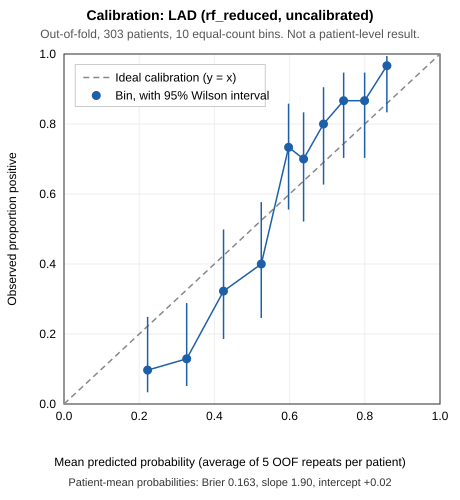
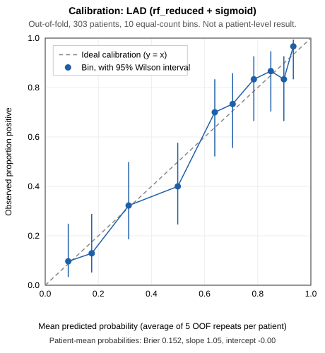

# LAD calibration experiment: uncalibrated vs sigmoid-calibrated random forest

> **Educational prototype. Not a diagnostic tool.** Internal repeated cross-validation on 303 patients from one centre. This is not external or clinical validation, and this experiment does not change the deployed model.

## Setup

- **Outer validation** (identical splits for both approaches): RepeatedStratifiedKFold, 5 folds × 5 repeats, `random_state=42`, stratified on LAD.
- **Labels:** 1 = `Stenotic` (177), 0 = `Normal` (126).
- **Features:** 48 inputs, exactly the deployed `rf_reduced` schema (20 numeric, 28 categorical). `Cath`, `LAD`, `LCX` and `RCA` are not inputs (checked by the script).
- **Baseline:** `train_phase1.make_pipeline` with the random-forest settings cloned from `models/phase1_candidates/LAD__rf_reduced.joblib` (`RandomForestClassifier(min_samples_leaf=3, n_estimators=300, n_jobs=-1,
                       random_state=42)`). Preprocessing is fitted on each training fold.
- **Calibrated:** `CalibratedClassifierCV(method='sigmoid', ensemble=False, cv=StratifiedKFold(5, shuffle=True, random_state=42))`, wrapped around the same unfitted pipeline and fitted on the outer training fold only (scikit-learn 1.9.1).
  - Inner cross-validated predictions on the training fold are used to fit the sigmoid.
  - The forest is then refitted on the whole training fold.
  - The outer validation fold is used only for scoring.
  - `ensemble=False` keeps it *the same forest plus a calibrator*, not an average of five forests trained on less data.
- **Fits:** 25 baseline and 150 calibrated. The seeds are the outer CV seed 42, the inner CV seed 42, the forest seed (from the deployed settings) and the bootstrap seed 20261011.
- **Baseline reproduction: REPRODUCED.** The largest difference from the saved LAD per-repeat out-of-fold predictions is 4.4e-16, and from the Phase 1 fold AUCs 1.1e-16.

## Results

Each value is computed on one repeat's 303 out-of-fold predictions and averaged over the 5 repeats. Brackets give 95% patient-level bootstrap intervals (2000 resamples; each patient keeps all 5 predictions). For differences, the same resamples are used for both approaches (paired).

| Group | Metric | Uncalibrated | Sigmoid | Difference (sigmoid − uncal.) | Repeats where sigmoid higher |
|---|---|---|---|---|---|
| discrimination | roc_auc | 0.847 (0.801–0.889) | 0.845 (0.798–0.888) | -0.002 (-0.004 to -0.001) | 0/5 |
| probability accuracy | brier | 0.164 (0.147–0.182) | 0.154 (0.131–0.179) | -0.010 (-0.018 to -0.002) | 0/5 |
| probability accuracy | log_loss | 0.504 (0.467–0.544) | 0.476 (0.417–0.538) | -0.029 (-0.054 to -0.002) | 0/5 |
| calibration | calibration_intercept | 0.021 (-0.193–0.247) | -0.002 (-0.265–0.289) | -0.024 (-0.105 to +0.067) | 1/5 |
| calibration | calibration_slope | 1.818 (1.464–2.314) | 1.001 (0.811–1.263) | -0.817 (-1.047 to -0.657) | 0/5 |
| calibration | mean_predicted | 0.580 (0.558–0.601) | 0.585 (0.552–0.616) | +0.005 (-0.006 to +0.015) | 4/5 |
| classification @0.5 | sensitivity | 0.886 (0.839–0.927) | 0.862 (0.811–0.908) | -0.024 (-0.039 to -0.011) | 0/5 |
| classification @0.5 | specificity | 0.643 (0.563–0.721) | 0.675 (0.597–0.750) | +0.032 (+0.015 to +0.053) | 5/5 |
| classification @0.5 | precision | 0.777 (0.719–0.835) | 0.788 (0.730–0.845) | +0.011 (+0.002 to +0.022) | 5/5 |
| classification @0.5 | recall | 0.886 (0.839–0.927) | 0.862 (0.811–0.908) | -0.024 (-0.039 to -0.011) | 0/5 |
| classification @0.5 | f1 | 0.828 (0.786–0.867) | 0.824 (0.780–0.863) | -0.004 (-0.014 to +0.005) | 1/5 |
| classification @0.5 | accuracy | 0.785 (0.739–0.828) | 0.784 (0.740–0.828) | -0.001 (-0.012 to +0.011) | 2/5 |

Ideal values: calibration slope 1 and intercept 0. Lower is better for Brier and log loss. The 25-fold means and SDs, comparable to the Phase 1 tables, are in `calibration_comparison.csv` (`*_fold_mean`, `*_fold_sd`).

## Reading the results (computed, not pre-judged)

- **Discrimination (ROC-AUC):** -0.002 (-0.004 to -0.001): lower at repeat level. Within each outer fold the ranking is unchanged: the largest per-fold ROC-AUC difference is 0.0e+00, because the calibrated pipeline contains the same forest and a monotone sigmoid. The repeat-level change arises because each fold has its own sigmoid, which shifts patients from different folds relative to each other when the 5 folds are pooled.
- **Brier score:** -0.010 (-0.018 to -0.002): better.
- **Log loss:** -0.029 (-0.054 to -0.002): better.
- **Calibration slope:** 1.82 → 1.00: closer to ideal (difference -0.817 (-1.047 to -0.657)).
- **Calibration intercept:** +0.02 → -0.00. Both are essentially 0 (difference -0.024 (-0.105 to +0.067)); calibration-in-the-large was already fine.
- **Threshold 0.5 classification:** sensitivity -0.024 (-0.039 to -0.011), specificity +0.032 (+0.015 to +0.053), precision +0.011 (+0.002 to +0.022), F1 -0.004 (-0.014 to +0.005), accuracy -0.001 (-0.012 to +0.011). These metrics change because calibration moves probabilities across 0.5. That change is a different operating point, not better or worse discrimination.

| Calibration plots (10 bins of about 30 patients; dashed line = ideal) | |
|---|---|
|  |  |

## Limitations

- 303 patients from one centre; 177 Stenotic and 126 Normal. The intervals are wide, and about 30 patients per calibration bin makes each plotted point uncertain.
- The intervals reflect only which patients were evaluated. They exclude retraining variability and the optimism from having selected `rf_reduced` among six candidates on these same folds. That selection happened before this experiment, so the baseline numbers are already somewhat optimistic.
- The calibrator for each fold is learned from about 242 training patients via inner CV, which is a small amount of data for estimating a sigmoid.
- The 0.5 threshold is not tuned or clinically optimised.
- If calibration is adopted, a new deployment artifact would be needed. It would be fitted on all 303 patients, so its calibration could not itself be checked on independent data.
- Nothing here shows clinical usefulness.

## Files

`calibration_comparison.csv` (all metrics, intervals and differences), `lad_calibration_predictions.csv` (patient × repeat out-of-fold probabilities with outer fold IDs), `repeat_metrics.csv`, `fold_metrics.csv` (with each fold's fitted sigmoid parameters a, b), `calibration_bins.csv`, the two SVG plots, `run_config.json` (seeds, versions, feature schema, input file hashes), `fit_warnings.csv` (every warning raised while fitting) and `lad_calibration_log.txt`.

**No decision is made here.** Whether to adopt calibration is left to review of these results.

## Warnings

- 1 'unknown category' warning(s) (sigmoid; outer folds [15]; feature(s) ['CVA']): a rare category was absent from a training split and was encoded as all zeros for those predictions. This is not leakage, but it is a small-sample effect.
